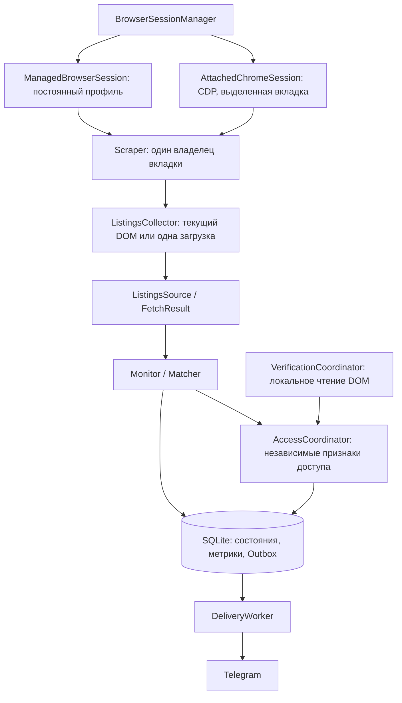

# Avito Monitor 3.0: браузерная сессия и восстановление

## Что изменено

Подробный аудит первого запуска: [browser-session-audit.md](browser-session-audit.md).
Ветка включает актуализацию main до `0259647`. Реальные проверки Авито при разработке не запускались.
Причины серверного 429 и совпадение внешнего IP обычного Chrome с ботом без измерений остаются неизвестными.



Telegram, DeliveryWorker, Supervisor, Watchdog и LaunchAgent сохраняют существующую схему работы.
Отказ Chrome или прокси не очищает подписки, историю цен, seen или очередь. Для 24/7 компьютер должен
быть включён, пользовательская сессия macOS доступна и сеть работоспособна; приложение не гарантирует
доступ к серверу Авито и не работает во время сна компьютера. После пробуждения выполняется одна
разрешённая проверка; сохранённые абсолютные сроки исключают накопление пачки пропущенных запросов.

## Настройка managed

Установите Google Chrome. В каталоге проекта:

```bash
uv sync --frozen --extra experimental
```

В `.env`:

```dotenv
BROWSER_SESSION_MODE=managed
BROWSER_ENGINE=patchright
BROWSER_CHANNEL=chrome
FETCH_MODE=light_fetch
HEADLESS=0
STARTUP_DIAGNOSTICS=1
```

Playwright также поддерживается: явно задайте `BROWSER_ENGINE=playwright`. Для действующего профиля
движок оставляют прежним. Значение по умолчанию в коде остаётся `playwright` для обратной совместимости.
Первый разрешённый опрос выполняет одну навигацию; затем `light_fetch` получает один HTML.
`page_navigation` доступен как явный альтернативный способ. Победитель заранее не назначается:
сравнивайте имеющиеся метрики длительности, запросов, байтов, ограничений и успешности с одинаковыми
настройками и исключением первой попытки из сравнения тёплых загрузок.

Постоянные каталоги:

| Движок | Chrome | Chromium (только явная настройка) |
|---|---|---|
| Playwright | `data/browser-profile-chrome` | `data/browser-profile` |
| Patchright | `data/browser-profile-patchright-chrome` | `data/browser-profile-patchright` |

Профили не копируются и не пересоздаются при ошибке. Cookies сохраняет Chrome. Перед изменением
настроек остановите сервис. Менеджер запрещает одновременное управление профилем и проверяет
живой Chrome SingletonLock до изменения настроек запуска. Сохранённые стартовые URL в managed
профиле отключаются, чтобы они не открывались до разрешения планировщика. Аварийный SingletonLock
обрабатывает сам Chrome; бот не удаляет его и не меняет профиль ради запуска. Непонятная блокировка,
невалидный Preferences или ошибка прав отображаются как ошибка сессии в `/health`.

## CDP на macOS (Chrome 136+)

CDP подключается только через Playwright. Укажите в `.env`:

```dotenv
BROWSER_SESSION_MODE=cdp_attach
BROWSER_ENGINE=playwright
BROWSER_CHANNEL=chrome
CDP_ENDPOINT=http://127.0.0.1:9222
CDP_PROFILE_DIR=./data/chrome-cdp-profile
STARTUP_DIAGNOSTICS=1
```

Запустите отдельный Chrome из каталога проекта:

```bash
mkdir -p "$PWD/data/chrome-cdp-profile"
chmod 700 "$PWD/data/chrome-cdp-profile"
"/Applications/Google Chrome.app/Contents/MacOS/Google Chrome" \
  --user-data-dir="$PWD/data/chrome-cdp-profile" \
  --remote-debugging-address=127.0.0.1 \
  --remote-debugging-port=9222 \
  --enable-automation \
  --no-first-run \
  --no-default-browser-check \
  about:blank
```

`--enable-automation` позволяет безопасно проверить командную строку через
`Browser.getBrowserCommandLine`: адрес, порт и фактический каталог профиля должны совпасть с конфигурацией.
Бот также проверяет реальный listener через `lsof` (на Linux возможна проверка `/proc/net/tcp*`),
запрещает wildcard/LAN и перенаправления локального endpoint. На macOS Chrome может дополнительно
слушать IPv6 loopback `::1`; соединение бота всегда идёт на `127.0.0.1`. Без возможности проверить listener
подключение завершается с диагностической ошибкой. Порт нельзя публиковать через туннели/port forwarding.

Системный профиль `~/Library/Application Support/Google/Chrome` и вложенные каталоги запрещены.
Отдельный каталог требуется и самим Chrome 136+: [изменение Chrome](https://developer.chrome.com/blog/remote-debugging-port).
Войдите в Авито вручную в этом отдельном профиле. Копирования cookies, паролей и обычного профиля нет.
Если оставлен `BROWSER_ENGINE=patchright`, источник выдаст явную ошибку, Telegram продолжит работать.
Patchright в этой реализации предназначен для managed; скрытого переключения движка нет.

Бот создаёт одну пустую выделенную вкладку. Другие вкладки, включая другие страницы Авито,
не используются для навигации. Идентификатор вкладки сохраняется в `avito-monitor-target` внутри
отдельного профиля и используется при переподключении; новая навигация ради подключения не выполняется.
Не удаляйте этот служебный файл при работающем Chrome. Можно открыть нужный каталог в выделенной
вкладке вручную. Свежий (до 120 секунд) DOM точного поиска используется один раз без загрузки.
Старая выдача не кэшируется как вечный результат; дальнейшие опросы идут по расписанию.

При отключении бот останавливает только клиентский transport, не вызывает `browser.close`,
`context.close` или `page.close`. Если пользователь закроет Chrome, в `/health` появится потеря
подключения и бот будет пробовать подключиться с ограниченным backoff. Он не запускает пользовательский
Chrome сам. После ручного запуска того же Chrome подключение восстановится; серверные сроки сохранятся.

## Доступ и HTTP 429

`AccessStatus` хранит независимо HTTP-код, срок и происхождение паузы, необходимость и подтверждение
проверки, отказ доступа, время последнего успеха и ограничения. `SourceState` остаётся совместимым
представлением для старого планировщика и отчётов.

| Ответ | Поведение |
|---|---|
| 429 без проверки | Локальный backoff: 900 секунд с удвоением до 6 часов; затем одна проверка |
| 429 со страницей проверки / IP check | Тот же срок плюс локальное наблюдение за открытой страницей |
| Любой ответ с Retry-After | Серверный срок сохраняется независимо от проверки и перезапуска |
| 200 с капчей | `VERIFICATION_REQUIRED`, только локальное наблюдение |
| 403 без подтверждённого каталога | `ACCESS_DENIED`, автоматических повторов нет |
| Нормальный каталог / явный маркер пустой выдачи | `OK` / `NO_RESULTS`, обычное расписание |
| Изменённая разметка | `PARSE_CHANGED`, диагностическая пауза |
| DNS/CONNECT/браузер недоступен | Транспортная ошибка или ошибка сессии; это не HTTP 429 Авито |

429 сам по себе не устанавливает признак капчи. Существующее распознавание HTTP 429 IP check сохранено:
дополнительной навигации для него нет. Нормальная выдача, открытая пользователем после ограничения,
также может подтвердить доступ в соответствии с актуальным main; старый DOM этого не доказывает.
Первый успешно загруженный документ с кодом 429 не используется как доказательство снятия запрета
из одного лишь HTTP-кода — требуется распознанный нормальный каталог при локальном наблюдении.

После ручного прохождения проверки проверяется **точное совпадение города, раздела и query**.
Нужны доказательства свежести: наблюдавшаяся страница ограничения, последующая навигация главного
фрейма в той же сессии либо время создания документа после ограничения при CDP. Навигация iframe
не подтверждает доступ. Переподключение имеет новый epoch и не наследует доверие к старому DOM.
Строгое совпадение query может потребовать открыть точный URL из настроек, если Авито изменил параметры
при редиректе; это осознанная консервативная граница, а не повод автоматически повторять запросы.

Подтверждение, изменение состояния, метрики, объявления и Outbox сохраняются одной транзакцией
с вложенными savepoint. Уведомления отправляются после коммита; завершение в памяти отмечается
после успешного сохранения. Ошибка записи допускает повторное подтверждение, не теряет объявления
и не снимает серверный срок. После успеха `/resume` не нужен, лишний `goto()` не выполняется.
Ограничения других городов не снимаются. Общий сетевой gate консервативно сохраняет остановку
запросов ко всему источнику, пока остаётся ограниченный город; общего восстановления по одному городу
без доказательства не предполагается.

## Диагностика и сетевой маршрут

```bash
uv run avito-diagnostics --startup
```

Команда читает SQLite в режиме read-only, не выполняет миграции, не запускает Chrome или прокси.
`STARTUP_DIAGNOSTICS=1` включает ограниченный журнал (до 2000 технических событий) в
`data/startup-diagnostics.json`, права `0600`. Сохраняются время, домен, тип, статус, домены редиректов,
длительность, фаза и маршрут. URL, query, headers, cookies, токены, HTML и тела не записываются.
Устаревшее (>15 секунд) состояние Chrome показывается как `unknown`. Настройки доступа берутся из
SQLite. Неполные сведения и отсутствие измерения внешнего IP всегда обозначаются `unknown`.

Наблюдатель подключается после запуска Chrome: запросы до его подключения технически неизвестны.
Поле «Requests before navigation» поэтому не подменяется нулём; отдельно показывается измеренное
число запросов после установки наблюдателя. В CDP пользовательский Chrome может иметь собственные
вкладки/расширения/фоновые запросы; телеметрия относится только к выделенной вкладке. Нельзя считать
её полным журналом браузера. Для managed также неизвестен ранний фоновый трафик самого Chrome.
Диагностика не добавляет обращений к Авито, IP-сервисам или отдельным тестовым URL.

DirectProxy использует один выбранный интерфейс для CONNECT и DoH. Bootstrap DoH — фиксированный
адрес Google DNS `8.8.8.8`, TLS проверяется для `dns.google`; системный DNS и переменные proxy для DoH
не используются. При отказе маршрута fallback на другой интерфейс не выполняется. Максимум 128
активных туннелей и 4 DoH-соединения; лишний CONNECT получает локальный 503. Остановка закрывает
listener, туннели, DNS-задачи и HTTP-пул. Внешний NAT/IP таким способом не измеряется.
При CDP DirectProxy не запускается, фактический маршрут пользовательского Chrome — `unknown`.

## Эксплуатация 24/7 и восстановление

Используйте существующий LaunchAgent/Supervisor по [autonomy.md](autonomy.md) и команды
`uv run avito-service --help`. Эти инструкции не устанавливают и не перезапускают сервис автоматически.

1. Перед обновлением остановите приложение и сделайте согласованную SQLite backup через `sqlite3.backup`
   или существующий `avito-service install`, который сохраняет резервную копию. Копируйте профиль только
   при закрытом Chrome. Сохраните `.env` отдельно с правами `0600`.
2. Выполните `uv sync --frozen --extra experimental`; запустите выбранный браузерный режим.
3. Проверьте `/health`, `avito-diagnostics --startup` и очередь. Недоступность источника и доступность
   Telegram показываются отдельно; отправленное сообщение не доказывает доступность каталога.
4. При капче пройдите её в выделенной вкладке. Бот читает DOM каждые `VERIFICATION_CHECK_SECONDS` без
   сетевых запросов и сохраняет подтверждение сам. Действующий Retry-After остаётся обязательным.
5. При закрытии managed Chrome менеджер использует тот же профиль. При потере CDP запустите отдельный
   Chrome с прежним каталогом и портом. Ошибку профиля устраняйте после остановки сервиса; не удаляйте
   каталог для обхода блокировки.
6. При отказе сети остаются сохранённые состояния/Outbox и ограниченный backoff. Watchdog отслеживает
   heartbeat; supervisor перезапускает зависший процесс. Во время сна проверок нет.

## Изменённые компоненты

- `browser_session.py`: BrowserSession protocol, ManagedBrowserSession, AttachedChromeSession,
  BrowserSessionManager; запуск/attach, получение выделенной вкладки, health, disconnect.
- `scraper.py`: start/stop через менеджер, сериализация check/fetch/load/read_current, пассивные события,
  инспекция 429 без дополнительной навигации, прежняя валидация Item и метрики способов загрузки.
- `access_coordinator.py`: AccessStatus, backfill старых ограничений, record/confirm.
- `verification.py`: pending/tick, epoch+generation, точное совпадение поиска, commit до `_confirmed`.
- `listings_collector.py`: same_search, check/consumed, одноразовое чтение свежего DOM.
- `db.py`: аддитивная таблица access_status и вложенные atomic-транзакции; старые таблицы сохраняются.
- `monitor.py`: ортогональные признаки, атомарное confirm_verification, health, ограниченное восстановление.
- `direct_proxy.py`: привязанный DoH transport, ограничение туннелей, health и полная остановка.
- `__init__.py`, `config.py`, `unblock.py`: wiring режимов, независимость Telegram, безопасная ручная проверка.
- `startup_diagnostics.py`, `diagnostics.py`, `pyproject.toml`, `uv.lock`: пассивный журнал/CLI и зависимость httpcore.
- `tests/test_session_recovery.py`, регрессионные тесты и документы: воспроизводимые локальные сценарии.

## Откат

Остановите сервис и managed Chrome. Сохраните текущую SQLite backup (чтобы не потерять новые подписки,
seen и Outbox); переключитесь на проверенную предыдущую ревизию `0259647`, выполните frozen sync
и верните прежние managed-настройки. Базовая ревизия задания — `e1577f6`, если нужен именно этот вариант.
Обе старые версии игнорируют новую таблицу access_status; их source_state сохраняет серверные сроки,
а прежние таблицы не удалены и совместимы. Поэтому обычно откат базы не требуется. Если понадобится
восстановить backup, это отдельная осознанная операция: изменения после backup будут утрачены.
Профиль оставьте на месте; не переносите cookies между движками. Пользовательский CDP Chrome
останавливает пользователь. Не сбрасывайте ограничения/`next_poll` при откате.

## Остаточные ограничения

Сервер может отказать даже при постоянном профиле и CDP. Возможны изменение DOM/параметров редиректа,
корпоративные политики Chrome, истечение сессии, отказ DoH, отсутствие доступа к интерфейсу и длительный
сон Mac. CDP имеет меньшую совместимость с некоторыми функциями Playwright; поддерживаемый путь
проверяется локальными тестами. Фоновый трафик Chrome до подключения наблюдателя не измерен.
Доставка использует существующий Outbox: дедупликация постановки надёжна, но при сбое между успешным
Telegram send и SQLite ack возможна повторная доставка (ограничение внешнего API без idempotency key).
Сборщик не проходит капчу автоматически, не меняет IP или профиль для сброса сроков и не обещает
гарантированного доступа к Авито.

## Результаты локальной проверки

26 октября 2026, Python 3.12, macOS, установленный Google Chrome:

```text
uv sync --frozen --extra experimental                     OK
uv run --extra experimental pytest -q                    277 passed in 45.60s
uv run --extra experimental python -m compileall -q src   OK
uv pip check                                              All installed packages are compatible
git diff --check                                          OK
```

Из них 30 новых сценариев/вариантов в `tests/test_session_recovery.py`. Остальные рабочие тесты сохранены;
в симуляциях истечения срока обновляются оба сохранённых представления, fake-конструктор принимает
новые параметры сессии. Проверены реальные managed-браузеры Playwright и Patchright и отдельный
Chrome с CDP на loopback. TLS/CONNECT/DoH тестируются на локальных серверах или mocks.

| Требование | Проверка |
|---|---|
| A: первый запуск | Пустая вкладка, отсутствие каталога до разрешённой загрузки, отключение restore URLs, сохранение cookie после рестарта обоих движков |
| B: CDP | Реальный отдельный Chrome, чтение имеющегося DOM и повторное подключение без новой загрузки |
| C/D: 429 + проверка / Retry-After | Независимые признаки доступа, автоматическое подтверждение и сохранение серверного срока |
| E: старый DOM | Старое поколение, другой query, новый epoch и старое время создания документа не подтверждают доступ |
| F: SQLite | Отказы записи состояния, события, Outbox и метрик откатывают транзакцию; повторное подтверждение проходит |
| G: города | Автоматическое подтверждение и `/unblock` не меняют состояние другого города |
| H: закрытие Chrome | Отсоединение не закрывает пользовательский процесс; потеря CDP обнаруживается, независимость Telegram проверена регрессиями runtime |
| I: маршруты | Фиксированный DoH bootstrap через тот же bind, реальный локальный TLS transport, закрытие/рестарт туннелей, отсутствие ложного 429 |
| J: объявления | Существующие end-to-end тесты проверки → Outbox → DeliveryWorker сохраняют дедупликацию |
| K: миграция | Сравнение содержимого подписок, seen, items, Outbox, цен, событий, метрик, наблюдений и действующего серверного срока до/после миграции |

Дополнительно: сериализация доступа двух задач к вкладке, безопасные диагностические поля/права файла,
повторная капча после уже подтверждённой проверки и истечения серверного срока, сохранение истории backoff другого города. Контакта с реальным
Авито при выполнении этих тестов нет. Успех локальных тестов доказывает корректность сценариев приложения;
он не измеряет доступность Авито в рабочей сети.
